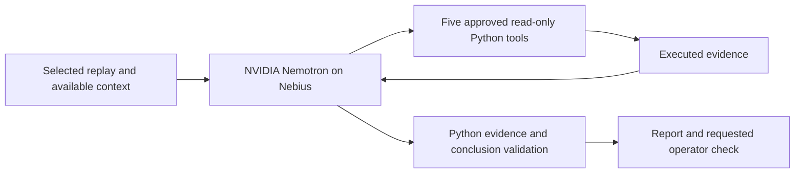

# Water Diagnostics

Investigate a suspicious turbidity signal, compare explanations and request the
next operator check, with an evidence trail a person can inspect.

Built for the Nebius × NVIDIA hackathon. NVIDIA Nemotron runs through Nebius
Token Factory; Python executes five approved read-only checks and constrains
conclusions, citations and report wording. A separate local policy demonstrates
one simulated collector reconnect followed by verification or escalation.

**Start with [JUDGE_GUIDE.md](JUDGE_GUIDE.md)** for setup and a free two-minute
walkthrough. No model download, GPU, VM or original research ZIP is required.

[Public repository](https://github.com/Sanidhya77/water-diagnostics) ·
[Download source test build](https://github.com/Sanidhya77/water-diagnostics/archive/refs/heads/main.zip)

## Run locally

Python 3.11 or newer, from this project folder in PowerShell:

```powershell
py -m venv .venv
.\.venv\Scripts\python.exe -m pip install -r requirements.txt
.\.venv\Scripts\python.exe -m water_diagnostics serve
```

Open the local URL printed by the server, normally http://127.0.0.1:8765.
Use `serve --port 8766` if needed. Keep the terminal running while using the app.
On macOS/Linux create the environment with `python3` and use `.venv/bin/python`.
Dependency installation needs internet access. The free walkthrough itself does
not. These commands do not require activation or Conda.

## What to try

- **Historical river replay:** compare evidence before and after a recorded
  cleaning visit at Udall on the Poudre River. The bundled April 1–7, 2024 subset
  contains original observations and available visit context. Future readings,
  unavailable notes and retrospective QC answers stay outside the investigation.
- **Signal inspection:** play, pause or scrub through actual recorded samples.
  The chart keeps gaps and the selected replay clock. Playback changes no report
  or evidence. Reduced motion uses a Next sample control.
- **Simulated cases:** six reproducible fixtures cover a held sensor reading,
  brief excursion, missing telemetry, maintenance disturbance, corroborating
  process change and ambiguous evidence. Three contrasting cases have bundled
  saved hosted reports. They are designed examples, not field accuracy.
- **Evidence and report:** open a completed check or report citation. Compare
  explanations and inspect uncertainty before requesting physical verification.
  Reports download as Markdown. Local checks produce a fresh free reference;
  saved Nemotron reports are prior inference and are labelled as saved.
- **Recovery simulation:** in Simulated cases, run Collector recovers and
  Collector stays offline. Each permits one in-memory reconnect. Independent
  readback must verify new packets; otherwise escalation is recorded. No real
  hardware operates and no notification is sent. The selected diagnosis remains
  separate from this recovery demo.
- **Reference guidance:** optional Tavily lookup requests current USGS, EPA and
  manufacturer background. This material never becomes incident evidence or
  changes a diagnosis.

Opening the page, changing cases, playback, saved results, local checks and
recovery simulations make no paid API calls.

## Hosted model and architecture



The hosted model is `nvidia/NVIDIA-Nemotron-3-Nano-30B-A3B`. It chooses checks
and submits a constrained conclusion through the Nebius Token Factory API at
`https://api.tokenfactory.us-central1.nebius.com/v1`. Python calculates results
and owns the report's alternatives, evidence citations and action wording. It
can reject unsupported or malformed output and mark the investigation incomplete.
The model is neither trained nor fine-tuned by this project.

For optional fresh inference, copy `.env.example` to `.env`, add your own
`NEBIUS_API_KEY`, restart the server and explicitly press Run with Nemotron.
Do not publish `.env`. Keys stay on the server. The loop is bounded, with no
automatic retries. The local reservation caps are $0.02 per investigation and
$5 for development. Reservations and token estimates are not actual billing;
Nebius billing is authoritative. Inspect development accounting with:

```powershell
.\.venv\Scripts\python.exe -m water_diagnostics budget-status
```

Tavily uses a separate optional `TAVILY_API_KEY`, a fixed public query, a
24-hour cache and a three-credit local development limit. No incident readings
or notes enter that query. The supplied build contains no guidance cache or keys.

Recovery action selection is a deterministic local policy. It audits a saved
communication-loss diagnosis when available, otherwise runs free local checks.
It does not ask Nemotron to select a new recovery action. The shipped driver has
no hardware, GPIO, shell, process-restart or device-network interface.

## Validation

```powershell
.\.venv\Scripts\python.exe -m pytest -q --basetemp .pytest-tmp-readme
.\.venv\Scripts\python.exe -m water_diagnostics validate-demo --mode saved
```

The October 22 local suite passed 155 tests. The bundled saved comparison audits
three designed synthetic fixtures at seed 0. It matched all three expected
outcomes without new inference. These checks describe the guarded
model-plus-Python workflow; they are not an independent benchmark. The saved
runs span earlier report-protocol versions and were not all rerun under one
identical protocol. Saved inference has no new measured latency.

The UI was checked at 1365, 1024, 768 and 390 px, including playback, reduced
motion, both recovery outcomes and downloads. Clean extracted source was checked
without credentials or the uploaded ZIPs, reusing installed dependency packages.

An [additional real-data week](evaluations/river-holdout-2024-04-08/README.md),
April 8–14 at Udall, was prepared from the existing archives without another
download. It contains 162 missing turbidity entries. Three fixed local replays
passed workflow-integrity checks, preserving missing values and uncertainty.
This is not a model-accuracy result or a fresh Nemotron evaluation. Reproduce it
with `python scripts/evaluate_river_holdout.py`; no API key is required.

## Package and submission

```powershell
.\.venv\Scripts\python.exe scripts/build_demo.py
```

This builds a small source test-build ZIP in `dist/`, with an SHA-256 manifest.
An explicit allowlist includes source, interface assets, tests, setup documents,
the attributed river subset and selected saved reports. It excludes credentials,
usage ledgers, browser profiles, the virtual environment and retrospective QC.
Existing output archives are never overwritten.

See [SUBMISSION_CHECKLIST.md](SUBMISSION_CHECKLIST.md) for remaining publication
steps and [DEMO_SCRIPT.md](DEMO_SCRIPT.md) for a 2:45 video outline. The build
script creates a local archive with a manifest. GitHub also provides the
downloadable source test build linked above. No hosted API access, video or
Devpost entry is created by the build.

See [EVALUATION_PLAN.md](EVALUATION_PLAN.md) for the completed additional-week
checks and the later hosted-review plan. More data is for evaluating the workflow;
no training job is part of this build.

## Boundaries and licenses

This is a laptop prototype for human review. Historical river data and synthetic
filter-outlet fixtures remain distinct. No treatment-plant connection, water
safety decision, alarm clearance, physical repair or nuclear qualification is
implemented. Raspberry Pi collection is future work. The demonstration of
telemetry recovery does not establish that elevated readings or water conditions
have been resolved.

Code: [MIT](LICENSE). Public river data: CC BY 4.0. IBM Plex Sans: SIL OFL 1.1.
Attribution, transformations and separate terms are in
[THIRD_PARTY.md](THIRD_PARTY.md).
